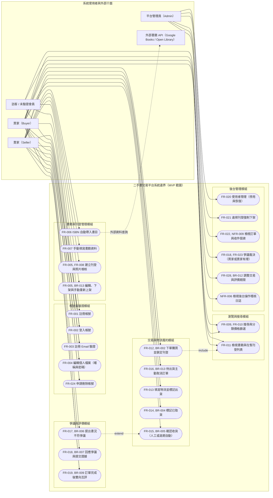
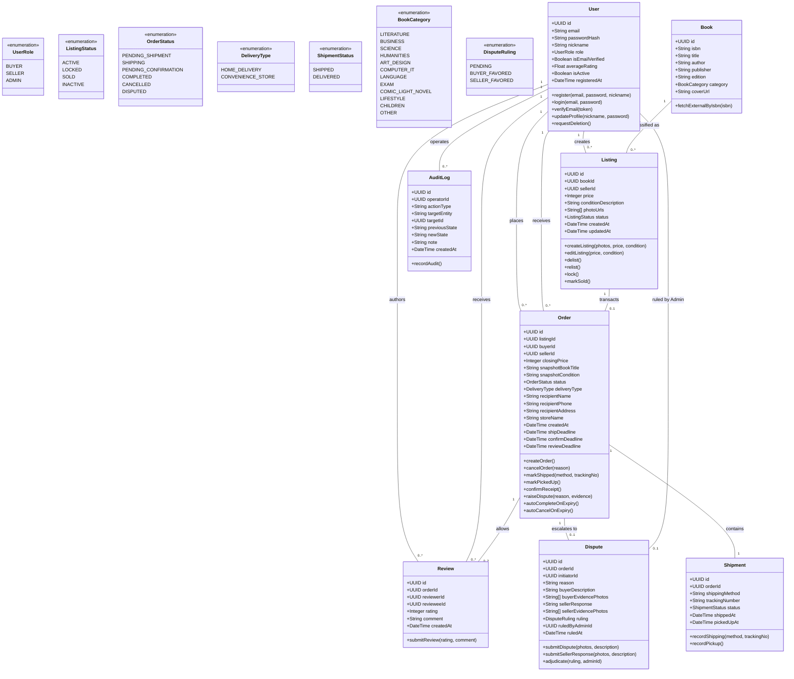
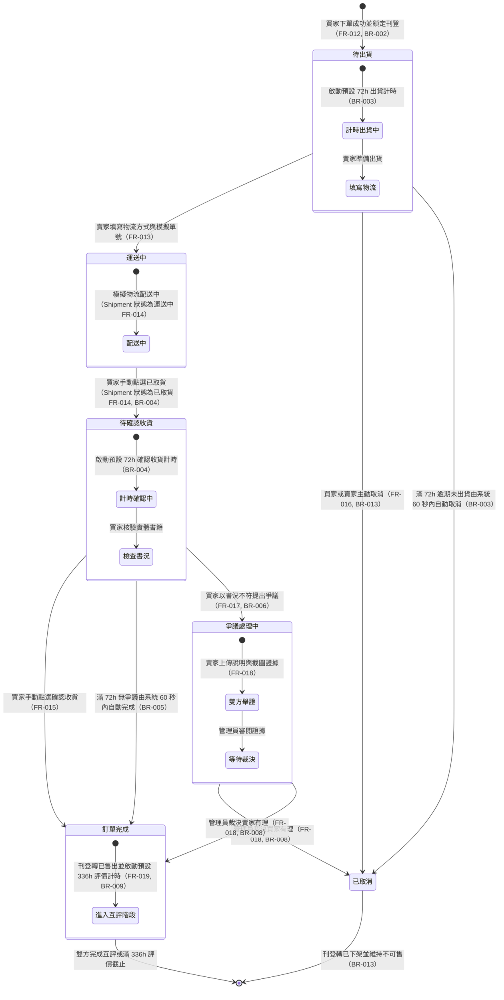
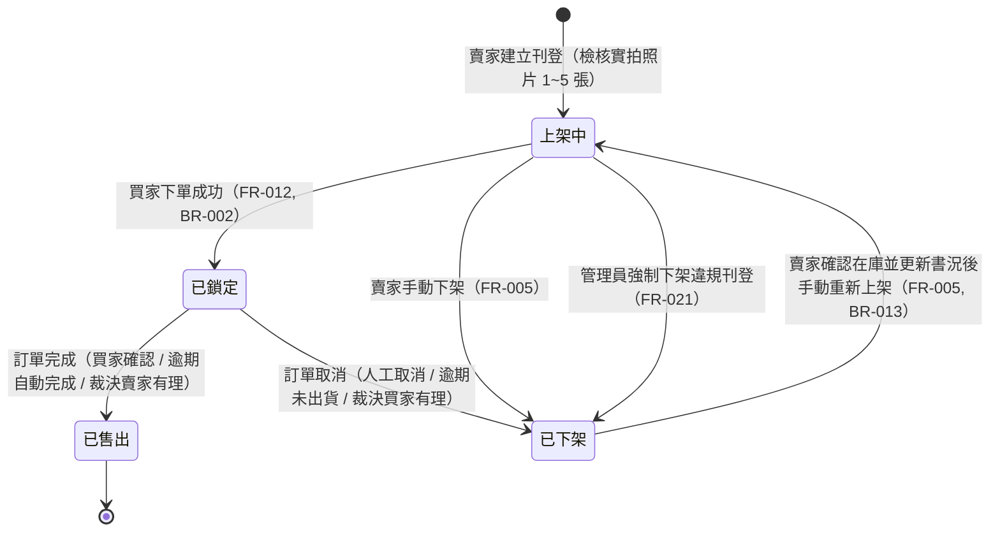
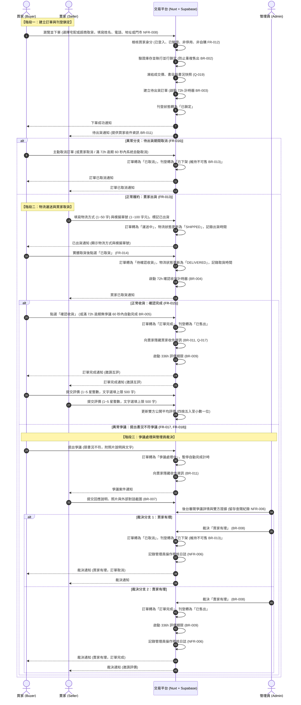

# 二手書交易平台系統分析與設計規格書（UML 模型）

| 項目 | 內容 |
| :--- | :--- |
| 文件版本 | v1.1 |
| 制定日期 | 2026-11-10 |
| 依據文件 | 軟體需求規格書（SRS）v1.0（需求基線定稿版本） |
| 專案方法 | Waterfall + AI |
| 目前階段 | 系統分析與架構設計（System Analysis & Design） |
| 審查狀態 | 需求基線對齊定稿（Baselined） |

---

## 1. 文件目的與系統範疇

### 1.1 文件目的
本文件依據《二手書交易平台軟體需求規格書（SRS）v1.0》之需求基線，建立正式的統一塑模語言（Unified Modeling Language, UML）系統分析與設計規格。內容涵蓋使用案例模型、領域靜態結構模型、系統狀態機模型及動態循序互動模型，作為後續系統實作（Nuxt.js + Supabase）與驗收測試之架構依據。

### 1.2 系統邊界與核心角色 (Actors)
本系統為專注於台灣個人讀者之 C2C 二手書交易平台。平台不經手真實款項，記錄履約進度並透過模擬物流完成交易閉環。本次 MVP 明確排除站內訊息、收藏、上架通知、**Email 修改功能**以及**獨立檢舉受理功能**。

| 角色 / 介面 | 類型 | 責任與權限範圍（依 SRS 第 2.3 節定稿） | 對應需求 |
| :--- | :--- | :--- | :--- |
| **訪客 / 未驗證會員** | 人類角色 | 瀏覽書籍與刊登清單、依條件搜尋篩選、註冊帳號、登入系統、執行註冊 Email 驗證。未完成驗證前禁止刊登實體書與下單購買。本次不提供註冊後變更 Email 之功能。 | FR-001～FR-003, Q-010 |
| **買家 (Buyer)** | 人類角色 | 檢視刊登詳情、對非自身刊登下單建立訂單、待出貨期間主動取消、確認取貨、於期限內確認收貨、提出書況不符爭議並舉證、訂單完成後評分評價。各交易操作僅限自己作為買家的訂單。 | FR-012, FR-014～FR-017, FR-019 |
| **賣家 (Seller)** | 人類角色 | 建立實體書刊登（實拍檢核）、維護自己的刊登狀態、出貨並填寫模擬物流資訊、待出貨期間主動取消、針對爭議案件回應與舉證、訂單完成後評分評價。各交易操作僅限自己作為賣家的訂單與刊登。 | FR-005～FR-008, FR-013, FR-018, FR-019 |
| **平台管理員 (Admin)** | 人類角色 | 使用者帳號管理（停用/恢復）、違規刊登強制下架、檢視訂單詳情（不可直接跳過流程變更狀態）、審閱爭議雙方證據並進行裁決、設定交易時限參數、查閱系統稽核紀錄。 | FR-020～FR-023, FR-028, NFR-005, NFR-006 |
| **外部書籍 API** | 外部系統 | 提供依國際標準書號（ISBN）自動查詢書目資料（Google Books API 或 Open Library API）。 | FR-006 |

---

## 2. 系統架構與技術約束

依據 SRS 之技術約束（NFR-010）與品質需求，本系統之實作規格約束如下：
1. **開發語言與框架**：採用 TypeScript 搭配 Nuxt.js 全端 Web 框架。
2. **後端服務架構**：採用 Supabase 平台，包含 PostgreSQL 關聯式資料庫、身份驗證機制（Supabase Auth）及物件儲存儲存庫（Supabase Storage）。具體版本與服務配置交接至設計階段細化。
3. **資訊安全規範**：
   - 密碼儲存採用 bcrypt 雜湊演算法，Cost Factor $\ge$ 10（NFR-004）。
   - 管理後台嚴格實施基於角色的存取控制（RBAC），一般使用者無權限進入（NFR-005）。
   - 後台敏感管理操作（停用帳號、強制下架、爭議裁決、時限調整）與收件個資查閱皆強制留存操作稽核紀錄（NFR-006）。
   - 圖片上傳僅支援 JPEG、PNG、WebP 格式，單張檔案上限 5 MB（NFR-007）。
   - 個資最小化（NFR-008）：下單依選擇「宅配」或「超商取貨」填寫對應收件欄位，不收集身分證字號或生日。

---

## 3. 使用案例模型 (Use Case Model)

### 3.1 系統使用案例圖
下圖展示系統邊界內各功能模組與各角色（Actors）之互動關係（已排除未納入之 Email 修改及獨立檢舉受理功能）：

### 3.2 使用案例說明表 (Use Case Specifications)

| 編號 | 使用案例名稱 | 主要參與者 | 前置條件 | 成果與後置狀態 | 需求來源 |
| :--- | :--- | :--- | :--- | :--- | :--- |
| **UC01** | 註冊帳號 | 訪客 | Email 未曾註冊 | 建立帳號實體，發送驗證連結，初始狀態為未驗證。 | FR-001 |
| **UC03** | 註冊 Email 驗證 | 訪客 / 會員 | 具有有效之註冊驗證連結 | 帳號驗證狀態標記為 true，開放刊登與下單權限。Email 於註冊後不可變更。 | FR-003, Q-010 |
| **UC04** | 編輯個人檔案 | 會員本人 | 已成功登入 | 僅允許修改暱稱與密碼；Email 欄位為唯讀不可修改。 | FR-004, Q-010 |
| **UC05** | 申請刪除帳號 | 會員本人 | 帳號無進行中訂單且無未結爭議 | 立即刪除登入憑證與個人檔案；既有交易與評價去識別化永久保留（署名顯示為「已刪除使用者」）。 | FR-024, Q-017 |
| **UC10** | 建立刊登 | 賣家 | 通過信箱驗證、已指定書目 | 檢核 1～5 張實拍照片並宣告實拍，刊登狀態設為「上架中」。 | FR-005, FR-008 |
| **UC11** | 管理刊登 | 賣家 | 刊登之擁有者本人 | 可編輯上架中刊登、手動下架。因訂單取消轉為「已下架」之刊登，賣家確認實體在庫並重新檢核後可手動重新上架。 | FR-005, BR-013 |
| **UC12** | 下單購買並鎖定 | 買家 | 買家已驗證、未停用、非自購、刊登上架中 | 填寫宅配或超商取貨必要收件資料，鎖定刊登實體（防止重複購買），凍結快照資料，建立待出貨訂單並啟動 72 小時出貨計時器。 | FR-012, BR-002, NFR-008 |
| **UC14** | 填寫物流並出貨 | 賣家 | 訂單處於「待出貨」且未逾期 | 必填自由文字物流方式（1～50 字）與模擬單號（1～100 字元），訂單轉為「運送中」，物流狀態更新為「SHIPPED」。 | FR-013, Q-006 |
| **UC15** | 標記已取貨 | 買家 | 訂單處於「運送中」 | 記錄取貨時間戳記，物流狀態更新為「DELIVERED」，訂單轉為「待確認收貨」，啟動 72 小時確認計時器。 | FR-014, BR-004 |
| **UC16** | 確認收貨 | 買家 / 系統 | 訂單處於「待確認收貨」且無爭議 | 手動確認或滿 72 小時系統自動完成，訂單轉為「訂單完成」，刊登轉為「已售出」，向賣家隱藏收件資料，開啟 336 小時評價期限。 | FR-015, BR-005 |
| **UC17** | 提出書況爭議 | 買家 | 處於「待確認收貨」且未逾期 | 原因限「書況不符」，上傳照片與說明，訂單轉為「爭議處理中」，暫停自動完成排程。 | FR-017, BR-006 |
| **UC18** | 回應爭議案件 | 賣家 | 訂單處於「爭議處理中」 | 賣家上傳文字說明、照片與外部對話截圖以供管理員佐證。 | FR-018, BR-007 |
| **UC23** | 裁決爭議 | 管理員 | 案件處於「爭議處理中」 | 裁決「買家有理」（轉已取消，刊登維持已下架不可售）或「賣家有理」（轉訂單完成，刊登轉已售出）。 | FR-018, FR-023, BR-008, BR-013 |
| **UC24** | 調整交易期限 | 管理員 | 具備管理員權限 | 以整數小時調整出貨、收貨確認及評價期限（範圍 1～720 小時），僅對調整後新開始階段生效。 | FR-028, BR-012 |

---

## 4. 領域靜態結構模型 (Domain Class Model)

### 4.1 領域類別圖 (Class Diagram)
領域靜態結構模型反映平台實體、屬性、列舉型別與關聯結構：

### 4.2 核心實體約束與資料字典說明
依據 SRS 第 6 節、第 6.1 節及第 7 節已確認之資料規格：

1. **書目與刊登分離機制 (BR-010)**：
   - `Book` 為客觀書目實體，以 ISBN 作為唯一主鍵去重；若無 ISBN 則不自動去重，不同版次視為獨立書目。
   - `Listing` 為特定賣家之實體書刊登，每筆刊登對應單一實體書。
2. **交易快照保存機制 (FR-012, Q-019)**：
   - 下單成立時，`Order` 實體必須凍結當前成交價格（`closingPrice`，NT$1～100,000 整數）、書名快照（`snapshotBookTitle`，上限 200 字）與書況描述快照（`snapshotCondition`，上限 2,000 字）。刊登後續編輯不影響既有訂單資料。
3. **收件資料與物流規格 (FR-013, FR-014, NFR-008, Q-006)**：
   - 下單時依 `deliveryType` 分流收集：
     - **宅配**：收件人姓名（1～50 字）、電話（8～20 碼）、地址（1～200 字）。
     - **超商取貨**：收件人姓名（1～50 字）、電話（8～20 碼）、超商名稱與門市名稱（1～200 字）。
   - 出貨必填自由文字物流方式（去除前後空白後 1～50 字）及模擬託運單號（1～100 字元，英數與連字號）。
   - 物流模擬狀態僅有 `SHIPPED`（運送中）與 `DELIVERED`（已取貨），分別由賣家出貨與買家取貨操作觸發。
4. **個資保護與資料保留規則 (NFR-008, NFR-009, BR-011, Q-017)**：
   - 買家收件資訊僅在「待出貨」、「運送中」、「待確認收貨」時提供給賣家；一旦進入「爭議處理中」、「訂單完成」或「已取消」，立即向賣家隱藏。
   - 使用者刪除帳號時，立即刪除其登入憑證與個人檔案，既有訂單與評價永久去識別化保留（署名顯示為「已刪除使用者」）；爭議證據與稽核日誌永久保留。**本次不提供按訂單結束時間定期自動刪除資料之功能**。

---

## 5. 系統狀態機模型 (State Machine Models)

### 5.1 訂單狀態機模型 (Order State Machine)
訂單生命週期由 6 種嚴格定義之狀態組成，受 NFR-002 一致性約束，不允許跳出流程外之任意轉移。

#### 訂單狀態轉移規則表

| 當前狀態 | 觸發事件 / 條件 | 目標狀態 | 系統動作與業務規則 |
| :--- | :--- | :--- | :--- |
| **初始** | 買家點選下單並通過買家身分與庫存檢核 | **待出貨** | 鎖定刊登實體（BR-002），凍結快照資料，依 Asia/Taipei 啟動預設 72 小時出貨計時。 |
| **待出貨** | 賣家於出貨期限內填妥物流標記出貨 | **運送中** | 記錄出貨時間戳記，物流狀態更新為 `SHIPPED`（FR-013）。 |
| **待出貨** | 買家或賣家主動取消（出貨期限內） | **已取消** | 人工取消無須對方同意，刊登轉為「已下架」並維持不可售（FR-016, BR-013）。 |
| **待出貨** | 滿 72 小時未出貨 | **已取消** | 系統於到期後 60 秒內自動取消，刊登轉為「已下架」並維持不可售（BR-003, BR-013）。 |
| **運送中** | 買家手動點選「已取貨」 | **待確認收貨** | 記錄取貨時間戳記，物流狀態更新為 `DELIVERED`，啟動 72 小時確認收貨計時（FR-014, BR-004）。 |
| **待確認收貨** | 買家手動點選「確認收貨」 | **訂單完成** | 刊登轉為「已售出」，向賣家隱藏收件資訊，開啟 336 小時評價期（FR-015）。 |
| **待確認收貨** | 滿 72 小時無爭議案件 | **訂單完成** | 系統於到期後 60 秒內自動確認收貨，刊登轉已售出（BR-005）。 |
| **待確認收貨** | 買家提出爭議（限「書況不符」） | **爭議處理中** | 暫停自動完成排程，向賣家隱藏收件資訊，通知賣家舉證（FR-017, BR-006）。 |
| **爭議處理中** | 管理員裁決「買家有理」 | **已取消** | 刊登轉為「已下架」並維持不可售（BR-013），寫入後台稽核紀錄（NFR-006）。 |
| **爭議處理中** | 管理員裁決「賣家有理」 | **訂單完成** | 刊登轉為「已售出」，開啟 336 小時評價期，寫入後台稽核紀錄（BR-008）。 |

---

### 5.2 刊登狀態機模型 (Listing State Machine)
刊登實體狀態分為：**上架中 (Active)、已鎖定 (Locked)、已售出 (Sold)、已下架 (Inactive)**。

#### 刊登狀態約束說明
1. **防止重複售出 (BR-002)**：下單成功即刻由「上架中」轉入「已鎖定」，禁止其他使用者下單或賣家編輯。
2. **取消不自動恢復可售 (BR-013)**：不論人工取消、逾期未出貨自動取消或爭議裁決買家有理，刊登皆明確轉為「已下架」，絕對不自動轉回上架中。
3. **重新上架條件 (FR-005, BR-013, Q-011)**：賣家確認仍持有該實體書、更新書況說明並通過實拍照片檢核後，方可手動轉回「上架中」；重新上架後產生的交易為全新訂單，不影響已取消舊訂單之歷史紀錄。

---

## 6. 動態互動模型：循序圖 (Sequence Model)

### 6.1 核心交易履約與爭議處理循序圖
循序圖描繪買家、賣家、平台系統與管理員在完整交易生命週期中之訊息傳遞與業務驗證流程，涵蓋異常取消分支、正常履約完成分支以及爭議裁決分支：

---

## 7. 需求可追溯性矩陣 (Traceability Matrix)

本矩陣將 SRS v1.0 定稿需求規格、業務規則映射至對應之 UML 模型元素，確保架構設計之完整性與可驗證性：

| 需求 / 規則編號 | 規格主題概要 | 對應 UML 模型元素 | 實作關鍵檢核點 |
| :--- | :--- | :--- | :--- |
| **FR-001～FR-003** | 帳號註冊、登入與註冊 Email 驗證 | 使用案例 UC01～UC03、類別 `User` | Email 唯一性、密碼 bcrypt 雜湊、未驗證權限隔離、註冊後 Email 唯讀不可修改。 |
| **FR-004** | 個人檔案維護 | 使用案例 UC04、類別 `User.updateProfile` | 僅允許修改暱稱與密碼，Email 不可修改。 |
| **FR-005, FR-008** | 刊登管理與實拍照片檢核 | 使用案例 UC10～UC11、類別 `Listing`、刊登狀態機 | 照片檢核 1～5 張、JPEG/PNG/WebP、賣家宣告實拍、取消後手動重新上架前置檢核。 |
| **FR-006, FR-007** | ISBN 自動帶入與手動建檔 | 使用案例 UC08～UC09、類別 `Book` | 整合 Google Books API，以 ISBN 為鍵進行書目去重。 |
| **FR-012, BR-002** | 下單並立即鎖定刊登 | 使用案例 UC12、類別 `Order`、訂單與刊登狀態機、循序圖階段一 | 買家身分驗證檢核、非自購檢核、防競爭重複下單、成交價與書況快照凍結。 |
| **FR-013, FR-014** | 物流出貨與買家模擬取貨 | 使用案例 UC14～UC15、類別 `Shipment`、循序圖階段二 | 自由文字物流（1～50 字）、模擬單號（1～100 字元）、記錄出貨/取貨時間、物流狀態轉移 `SHIPPED` / `DELIVERED`。 |
| **FR-015, BR-005** | 確認收貨與自動結案 | 使用案例 UC16、訂單狀態機、循序圖正常收貨分支 | 人工確認或滿 72 小時 60 秒內自動結案、刊登轉已售出、向賣家隱藏收件資料。 |
| **FR-016, BR-013** | 待出貨主動與逾期取消 | 使用案例 UC13、訂單狀態機、刊登狀態機、循序圖異常分支 | 滿 72 小時 60 秒內自動取消、所有取消均將刊登轉為「已下架」且維持不可售。 |
| **FR-017, FR-018** | 提出爭議與管理員裁決 | 使用案例 UC17～UC18, UC23、類別 `Dispute`、循序圖爭議分支 | 限書況不符、提交照片與對話截圖、裁決結果僅買家有理（轉已取消，刊登維持已下架）與賣家有理（轉訂單完成，刊登轉已售出）。 |
| **FR-019, BR-009** | 雙向評分與文字評價 | 使用案例 UC19、類別 `Review`、循序圖階段三結案 | 1～5 星整數、上限 500 字、僅訂單完成可評、336 小時時效判定。 |
| **FR-020～FR-023** | 後台資料管理與權限 | 使用案例 UC20～UC23、類別 `AuditLog` | 管理員 RBAC 權限、不可越權跳轉訂單狀態、操作稽核永久留痕。 |
| **FR-024** | 刪除帳號與資料保留 | 使用案例 UC05、類別 `User.requestDeletion` | 無未結訂單與爭議方可刪帳；立即刪除帳號個資，交易與評價永久去識別化保留，不提供定期自動刪除排程。 |
| **FR-028, BR-012** | 調整交易與評價期限 | 使用案例 UC24、類別 `AuditLog` | 以整數小時輸入（1～720 小時）、時區 Asia/Taipei、僅對未開始階段生效、記錄修改前後值。 |

---

## 8. 版本修訂歷程

| 版本 | 修訂日期 | 變更說明 | 審查狀態 |
| :--- | :--- | :--- | :--- |
| **v1.0** | 2026-11-10 | 依據 `SRS.md` v0.4 規格初稿建立系統分析與設計規格書，發布 5 大核心 UML 模型、實體資料字典與追溯矩陣。修正 Mermaid 標籤括號語法解析問題。 | 待審查（Pending Review） |
| **v1.1** | 2026-11-10 | **全面對齊 `SRS.md` v1.0 需求基線定稿版本**： 1. 依客戶決議移除 Email 修改功能，更新 UC03、UC04、類別圖 `User`（移除 `updateEmail`）及需求追溯矩陣（移除原 BR-014）。 2. 移除 180 天自動刪除規則，更新資料保留規範（刪帳時個人檔案立即刪除，交易與評價永久去識別化保留）。 3. 結清下單前置檢核（已驗證、非自購、收件欄位 NFR-008）、物流欄位格式（1～50 字 / 1～100 字元）與模擬狀態（`SHIPPED` / `DELIVERED`）。 4. 明確取消訂單後刊登轉為「已下架 (Inactive)」及賣家手動重新上架前置檢核（FR-005, BR-013）。 5. 結清交易期限調整單位（整數小時 1～720 小時，時區 Asia/Taipei）及超時 60 秒排程容許延遲（BR-003, BR-005）。 | 需求基線對齊定稿（Baselined） |
