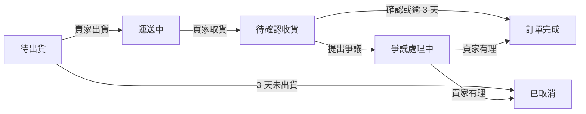

# 二手書交易平台基礎規格書

> **版本資訊**：Nov 1, 2026 @GaoJie0648  
> **概述**：本規格描述一個讓個人賣家與買家安全交易二手書的網頁平台，只說明題目與初步構想，不規定分析方法、文件格式或工具。

---

## 產品定位

平台服務台灣的個人買賣雙方，以統一的訂單流程與評價解決二手書交易的信任問題。本專題不實際上架營運，不處理收費、金流與商業模式。

* **目標賣家**：想清理書櫃的學生、家長與一般讀者。
* **目標買家**：想省錢買教科書，或尋找絕版書的讀者。
* **主要痛點**：社群社團交易分散，書況描述不一致，賣家信用也難以判斷。
* **MVP 型態**：響應式網站，先做個人對個人（C2C），不做二手書店後台。

---

## 訂單流程

每筆訂單都依下圖轉換狀態，平台只記錄交易進度，不經手款項。買家確認收貨後，訂單才算完成。

> **流程說明**：訂單狀態流程共包含 6 個狀態、2 個異常分支。

---

## MVP 範圍

MVP 必須讓一本書走完上架、下單、出貨、收貨到評價的完整流程。

| 模組 | 功能 | 優先級 | 最低要求 |
| :--- | :--- | :---: | :--- |
| **帳號** | 註冊登入、個人檔案 | 必做 | 需驗證 Email |
| **上架** | 建立與管理刊登 | 必做 | 輸入 ISBN 帶入書籍資料，也可手動填寫；至少 1 張實拍照片 |
| **瀏覽** | 搜尋、篩選、書籍頁 | 必做 | 可依書名、作者、ISBN 搜尋，依分類、價格篩選 |
| **交易** | 下單、出貨、收貨確認 | 必做 | 賣家標記出貨，買家確認收貨；物流以模擬方式呈現 |
| **售後** | 取消、爭議、評價 | 必做 | 買賣雙方互評；爭議由管理員裁決 |
| **管理** | 後台 | 必做 | 可管理使用者、刊登、訂單、爭議 |
| **溝通** | 站內訊息 | 建議 | 可針對刊登提問 |
| **留存** | 收藏、到貨通知 | 建議 | 指定書籍上架時通知 |

### MVP 不做事項
* 原生 App
* 競標
* 以物易物
* 實體店面後台
* 跨境交易
* 線上付款
* 真實物流串接
* 平台收費

---

## 核心資料

同一本書的書目資料與每次刊登分開存放，同一書目才能有多筆賣家刊登。

| 實體 (Entity) | 代表什麼 | 關鍵欄位 |
| :--- | :--- | :--- |
| **User** | 使用者 | 暱稱、Email、角色、平均評價 |
| **Book** | 書目資料 | ISBN、書名、作者、出版社、版次、分類、封面 |
| **Listing** | 一本實際待售的書 | 賣家、書目、書況說明、價格、照片、狀態 |
| **Order** | 一筆交易 | 買家、賣家、刊登、成交價、下單時間、訂單狀態 |
| **Shipment** | 物流紀錄 | 訂單、物流方式、託運單號、物流狀態、出貨時間、取貨時間 |
| **Dispute** | 爭議案件 | 訂單、原因、證據、裁決結果 |
| **Review** | 交易評價 | 訂單、評價者、被評價者、星等、內容 |
| **Message** | 站內訊息 | 刊登、寄件者、收件者、內容、時間 |
| **Favorite** | 收藏與上架通知 | 使用者、書目、是否通知 |

---

## 業務規則

> *註：所有天數皆為預設值。*

| 規則項目 | 規格與預設值 |
| :--- | :--- |
| **庫存** | 一筆刊登代表一本實體書；下單後立即鎖定，不可重複售出。 |
| **出貨期限** | 下單後 3 天內未出貨，自動取消訂單。 |
| **收貨確認** | 買家取貨後 3 天內可確認或提出爭議；逾期自動確認。 |
| **爭議** | 僅限未確認收貨的訂單；書況不符時由管理員依照片與訊息裁決。 |
| **評價** | 訂單結束後 14 天內可互評。 |

---

## 品質要求

以下是平台應達到的最低要求，技術做法不限：

* **一致性**：訂單狀態只能依流程轉換；同一本書不可被賣出兩次。
* **安全**：密碼須雜湊保存；管理後台須有角色權限與操作紀錄；上傳圖片須檢查類型與大小。
* **個資**：只收集交易必要資料，買家收件資訊僅在訂單進行中提供給賣家，使用者可申請刪除帳號。